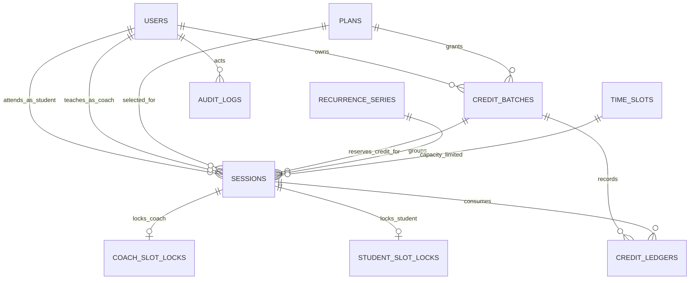
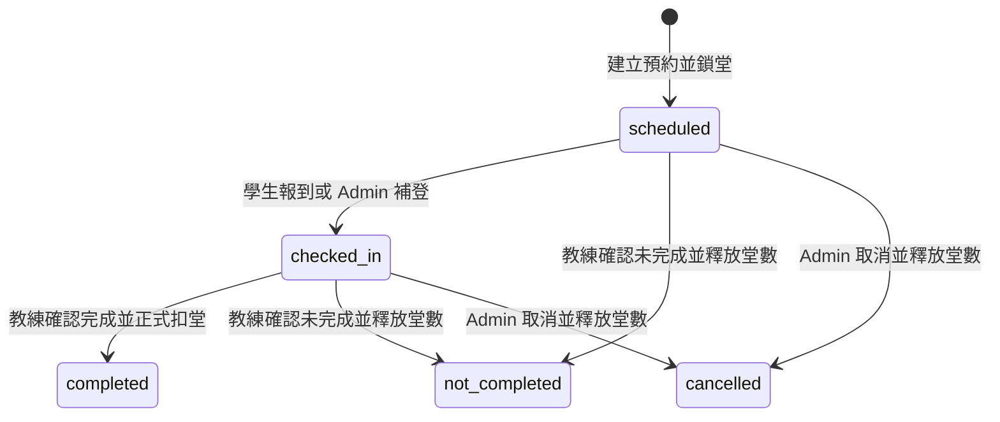

# Firestore Schema 與資料關聯

本文件描述 `ray-app` 目前實際使用的 Firestore 資料模型。Firestore 並非關聯式資料庫，以下所稱「表」實際上是 collection；關聯不會由資料庫外鍵強制，而是由文件 ID、關聯欄位與 Firestore transaction 維護。

共用方案與作廢的操作、舊資料限制及驗收步驟，見 [shared-credits-testing.md](shared-credits-testing.md)。

## 整體關聯

## Collection 一覽

| Collection | 文件 ID | 用途 |
| --- | --- | --- |
| `users` | LINE User ID (`profile.sub`) | 會員、教練與管理員帳號 |
| `users/{userId}/creditBatches` | Auto ID | 每次方案儲值形成的堂數批次 |
| `plans` | Auto ID | 可購買的課堂方案定義 |
| `sessions` | Auto ID | 每一堂實際課程預約 |
| `recurrenceSeries` | Auto ID | 重複課程的系列摘要 |
| `timeSlots` | 課程開始時間的 Unix milliseconds | 同時段容量計數，預設最多 4 堂（可由 Admin 調整） |
| `coachSlotLocks` | `{coachId}_{startAtMillis}` | 防止同一教練同時段重複預約 |
| `studentSlotLocks` | `{studentId}_{startAtMillis}` | 防止同一學生同時段重複預約 |
| `creditLedgers` | Auto ID | 堂數增加與正式扣除流水 |
| `auditLogs` | Auto ID | 管理操作與課程狀態異動稽核 |

## `settings/scheduling`

管理全館同時段課程上限。`slotCapacity` 為 1 至 100 的整數，沒有設定時預設為 4；`updatedBy`、`updatedAt` 記錄最後修改者及時間。僅 Admin 可從「設定」頁或 `PATCH /api/settings/scheduling` 修改，並寫入 `settings.scheduling_updated` audit log。

新增及移動課程會在同一交易內讀取此文件，避免設定與排課競爭時沿用舊上限。調低上限不取消已排課程，已達或超過上限的時段不可新增／移入，仍可編輯原時段課程或取消。`GET /api/sessions` 一律回傳 `slotCapacity`，即使時段列表為空，行事曆仍能正確顯示容量。

## `users`

路徑：`users/{userId}`

`userId` 固定使用 LINE Login 回傳的 subject。單一帳號可同時具有多個角色。

| 欄位 | 型別 | 說明 |
| --- | --- | --- |
| `lineUserId` | string | LINE User ID，通常與文件 ID 相同 |
| `displayName` | string | LINE 顯示名稱 |
| `realName` | string | 使用者填寫的本名 |
| `nickname` | string | 使用者填寫的綽號 |
| `pictureUrl` | string? | LINE 頭像 URL |
| `email` | string? | LINE Login 提供的 Email |
| `roles` | string[] | `admin`、`coach`、`student`，可複選 |
| `status` | string | 目前使用 `active` 或 `disabled` |
| `credits.totalRemaining` | number | 此帳號名下批次的剩餘快取，包含共用批次；不代表本人全部可用餘額 |
| `credits.reserved` | number | 此帳號名下批次的占用快取，包含其他共用會員預約 |
| `sharedCreditBatchPaths` | string[]? | 此會員加入的其他帳號名下批次完整路徑，僅用於查找；仍需驗證批次的 `memberIds` |
| `createdAt` | Timestamp | 首次 LINE 登入時間 |
| `updatedAt` | Timestamp | 最近更新時間 |

API 的 `credits` 由本人批次及有權使用的共用批次即時計算，排除過期、作廢批次並按完整路徑去重。包含 `totalRemaining`、`reserved`、`available`、`personalRemaining`、`sharedRemaining` 與依方案彙總的 `plans`。不將同一份餘額複製到每位共用會員。

### `creditBatches` 子集合

路徑：`users/{userId}/creditBatches/{batchId}`

每次替會員儲值一個方案，都建立一個獨立批次。預約同一方案時，優先使用最早到期且仍有可預約堂數的批次。

共用時保留原路徑與原始歸屬會員；參與者都從同一筆批次扣堂。舊批次沒有 `memberIds` 時視為僅原始歸屬會員可用，不需要搬移舊資料。

| 欄位 | 型別 | 說明 |
| --- | --- | --- |
| `originalUnits` | number | 此次儲值的原始堂數 |
| `remainingUnits` | number | 尚未正式消耗的堂數，包含已預約堂數 |
| `reservedUnits` | number | 此批次已被課程鎖定的堂數 |
| `planId` | string | 對應 `plans/{planId}` |
| `planName` | string | 儲值當下的方案名稱快照 |
| `grantedBy` | string | 執行儲值的 Admin user ID |
| `grantedAt` | Timestamp | 儲值時間 |
| `expiresAt` | Timestamp | 到期時間，目前為儲值日起十年 |
| `note` | string | 儲值備註 |
| `memberIds` | string[]? | 可使用的會員，包含原始歸屬會員；最多 20 人 |
| `status` | string? | `active` 或 `voided`；舊資料未設定視為 active |
| `hasBeenReserved` | boolean? | 新儲值為 false，首次預約或處理既有預約後永遠為 true；舊資料缺少此值時禁止作廢 |
| `voidedAt` / `voidedBy` | Timestamp? / string? | 作廢時間及操作者 |
| `voidReason` | string? | 作廢原因 |

批次可預約堂數：`remainingUnits - reservedUnits`。

作廢需同時滿足 `hasBeenReserved === false`、`remainingUnits === originalUnits`、`reservedUnits === 0` 且尚未作廢。作廢將 remainingUnits 歸零、標記狀態，寫入反向流水與 audit log，保留原始堂數。預約、改課、完成、取消、作廢都交易讀寫同一筆批次，避免競爭時超用或重複扣除。

## `plans`

路徑：`plans/{planId}`

| 欄位 | 型別 | 說明 |
| --- | --- | --- |
| `name` | string | 方案名稱 |
| `sessions` | number | 每次購買增加的堂數 |
| `price` | number | 每堂價格（NT$） |
| `active` | boolean | 是否上架；停用方案仍保留歷史關聯 |
| `sortOrder` | number | 顯示順序；啟用與停用方案各自在群組內排序 |
| `createdAt` | Timestamp | 建立時間 |
| `updatedAt` | Timestamp | 最近更新時間 |

列表排序規則：先顯示 `active = true`，再依 `sortOrder`；停用方案自動置底。舊資料若沒有 `sortOrder`，會再依堂數與名稱排序。

## `sessions`

路徑：`sessions/{sessionId}`

| 欄位 | 型別 | 說明 |
| --- | --- | --- |
| `studentId` | string | 對應 `users/{studentId}` |
| `studentName` | string | 建立／編輯課程時的學生名稱快照 |
| `coachId` | string | 對應 `users/{coachId}` |
| `coachName` | string | 建立／編輯課程時的教練名稱快照 |
| `planId` | string | 此堂課使用的方案 |
| `planName` | string | 此堂課的方案名稱快照 |
| `creditBatchId` | string | 對應 `users/{creditOwnerId}/creditBatches/{creditBatchId}` |
| `creditOwnerId` | string? | 儲值原始歸屬會員；舊預約未設定時回退至 `studentId` |
| `startAt` | Timestamp | 課程開始時間 |
| `endAt` | Timestamp | 課程結束時間，目前固定為開始後一小時 |
| `status` | string | 課程狀態，見下方狀態流程 |
| `seriesId` | string/null | 重複課程時對應 `recurrenceSeries/{seriesId}` |
| `createdBy` | string | 建立者 user ID |
| `createdAt` | Timestamp | 建立時間 |
| `updatedBy` | string? | 最近編輯者 user ID |
| `updatedAt` | Timestamp | 最近更新時間 |
| `checkedInAt` | Timestamp? | 學生報到時間 |
| `checkedInBy` | string? | 報到或補登操作者 user ID |
| `completedAt` | Timestamp? | 教練確認結果的時間 |
| `completedBy` | string? | 確認結果的教練或 Admin user ID |
| `incompleteReason` | string? | 未完成原因代碼 |
| `incompleteNote` | string? | 未完成說明 |
| `cancelledAt` | Timestamp? | 取消時間 |
| `cancelledBy` | string? | 取消操作的 Admin user ID |
| `cancellationReason` | string? | 取消原因 |

### 課程狀態流程

重要規則：

- `studentId` 不可等於 `coachId`。
- 每個開始時段預設最多 4 堂（可由 Admin 調整）課程。
- 同一教練或學生在同時段只能有一堂課。
- 建立預約只增加 `reserved` / `reservedUnits`，不減少 `remainingUnits`。
- `completed` 才會同時減少 `remainingUnits`、`reservedUnits` 與儲值歸屬會員快取的 `totalRemaining`、`reserved`。上課會員仍記在 `studentId`。
- `not_completed` 或 `cancelled` 只釋放預約，不正式扣堂。

## `recurrenceSeries`

路徑：`recurrenceSeries/{seriesId}`

只有一次建立多堂重複課程時才產生。

| 欄位 | 型別 | 說明 |
| --- | --- | --- |
| `studentId` | string | 學生 user ID |
| `coachId` | string | 教練 user ID |
| `planId` | string | 使用方案 ID |
| `planName` | string | 方案名稱快照 |
| `frequency` | string | `daily`、`weekly` 或 `monthly` |
| `count` | number | 系列包含的課程數 |
| `startAt` | Timestamp | 第一堂開始時間 |
| `endAt` | Timestamp | 最後一堂開始時間 |
| `createdBy` | string | 建立者 user ID |
| `createdAt` | Timestamp | 建立時間 |

`sessions.seriesId` 指向此文件；目前編輯或取消單堂課不會自動改寫整個系列。

## 容量與衝堂鎖

### `timeSlots`

路徑：`timeSlots/{startAtMillis}`

| 欄位 | 型別 | 說明 |
| --- | --- | --- |
| `startAt` | Timestamp | 時段開始時間 |
| `count` | number | 此時段目前課程組數，受 settings/scheduling.slotCapacity 限制；調低上限時保留既有課程 |
| `sessionIds` | string[] | 此時段包含的 session IDs |

### `coachSlotLocks`

路徑：`coachSlotLocks/{coachId}_{startAtMillis}`

| 欄位 | 型別 | 說明 |
| --- | --- | --- |
| `sessionId` | string | 對應課程 ID |
| `coachId` | string | 教練 user ID |
| `startAt` | Timestamp | 時段開始時間 |

### `studentSlotLocks`

路徑：`studentSlotLocks/{studentId}_{startAtMillis}`

| 欄位 | 型別 | 說明 |
| --- | --- | --- |
| `sessionId` | string | 對應課程 ID |
| `studentId` | string | 學生 user ID |
| `startAt` | Timestamp | 時段開始時間 |

以上三種文件會與 `sessions` 在同一個 transaction 建立、移動或釋放，避免容量計數與課程資料不同步。

## `creditLedgers`

路徑：`creditLedgers/{ledgerId}`

堂數流水採 append-only。會寫入 `grant`、`consume` 與 `void`；取消或未完成屬於釋放預約，沒有額外流水。

| 欄位 | 型別 | 說明 |
| --- | --- | --- |
| `userId` | string | 會員 user ID |
| `type` | string | `grant`、`consume` 或 `void` |
| `quantity` | number | 儲值為正數；消耗固定為 `-1`；作廢為該筆剩餘堂數的負數 |
| `batchId` | string | 對應儲值原始歸屬會員的 `creditBatches/{batchId}` |
| `creditOwnerId` | string? | 新的消耗／作廢流水會記錄批次歸屬；consume 的 userId 仍是實際上課人 |
| `planId` | string | 方案 ID |
| `planName` | string | 方案名稱快照 |
| `sessionId` | string? | `consume` 時對應課程 ID |
| `actorId` | string | 執行者 user ID |
| `note` | string? | 儲值備註 |
| `createdAt` | Timestamp | 流水建立時間 |

## `auditLogs`

路徑：`auditLogs/{logId}`

| 欄位 | 型別 | 說明 |
| --- | --- | --- |
| `action` | string | 操作代碼 |
| `actorId` | string | 操作者 user ID 或維護腳本識別字 |
| `targetId` | string? | 主要受影響文件 ID |
| `metadata` | map? | 操作相關參數快照 |
| `createdAt` | Timestamp | 操作時間 |

目前常見 action：

- `user.roles_updated`
- `credits.granted`
- `credits.member_added`、`credits.voided`
- `plan.created`、`plan.updated`、`plans.reordered`
- `sessions.created`、`session.updated`
- `session.checked_in`、`session.checkin_backfilled`
- `session.completed`、`session.not_completed`、`session.cancelled`
- `maintenance.bookings_and_credits_reset`

## 一致性與反正規化

Firestore 沒有 join，因此以下名稱會保存快照：

- `sessions.studentName` / `sessions.coachName`
- `sessions.planName`
- `creditBatches.planName`
- `creditLedgers.planName`

修改會員名稱或方案名稱不會回寫歷史課程與流水。這能保留報表當時的顯示內容，但也代表歷史名稱可能與目前主檔不同。

使用者文件中的 `credits` 保留為其名下批次的相容快取；API 顯示餘額以有權使用的 `creditBatches` 為準。所有預約、完成、未完成、取消與作廢操作必須透過 transaction service 更新批次及原始歸屬會員快取，不應直接在 Console 單獨修改其中一邊。

## 查詢與 Index

`firestore.indexes.json` 目前定義以下 `sessions` 複合索引：

1. `studentId ASC, status ASC, startAt ASC`
2. `studentId ASC, startAt ASC`
3. `coachId ASC, status ASC, endAt DESC`
4. `status ASC, endAt DESC`

目前主要範圍查詢還包括：

- `sessions.startAt >= from AND startAt < to ORDER BY startAt ASC`
- `sessions.endAt <= now ORDER BY endAt DESC`
- `timeSlots.startAt >= from AND startAt < to ORDER BY startAt ASC`
- `users.roles ARRAY_CONTAINS role`

單欄位查詢通常由 Firestore 自動索引處理；若日後將角色或狀態過濾下推至同一查詢，應同步更新 `firestore.indexes.json`。

## 存取方式與安全規則

前端不直接連線 Firestore。所有資料存取都經由 Next.js server route 與 Firebase Admin SDK；`firestore.rules` 對所有 client read/write 設為 `false`。角色權限由 server session 檢查：

- Admin：會員、方案、報表與所有課程管理。
- Coach：只建立、查看與修改自己的課程；可查看自己的待確認課程。
- Student：查看個人資料、方案堂數、自己的預約與打卡。

## 清除腳本

`npm run data:reset-bookings-credits` 會刪除：

- `sessions`
- `recurrenceSeries`
- `timeSlots`
- `coachSlotLocks`
- `studentSlotLocks`
- `creditLedgers`
- 所有 `users/{userId}/creditBatches`

並將每位會員的 `credits` 歸零、移除 `sharedCreditBatchPaths`。此腳本會保留 `users`、`plans` 與既有 `auditLogs`，並新增一筆 maintenance audit log。這是破壞性操作，只應對確認過的 GCP project / Firestore database 執行。
